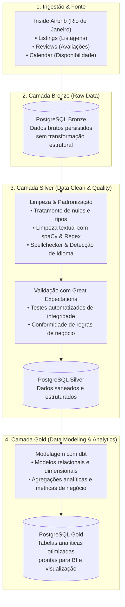

# 🏙️ Pipeline de Analytics Engineering - Airbnb Rio de Janeiro

Projeto prático de **Engenharia de Analytics e Dados** desenvolvido durante o programa **Santander Coders** (trilha de Dados / Engenharia de Analytics), implementando a arquitetura Medalhão (**Bronze, Silver e Gold**) sobre a base de dados pública do *Inside Airbnb* do Rio de Janeiro.

---

## 📐 Arquitetura da Solução

O pipeline segue as melhores práticas modernas de governança, qualidade e transformação de dados:



---

## 🎯 Etapas do Projeto

### 1. Ingestão e Camada Bronze (Raw Storage)
- Download e extração programática dos dados públicos do *Inside Airbnb*.
- Conexão com banco de dados **PostgreSQL** via `SQLAlchemy` e `psycopg2`.
- Armazenamento dos dados brutos nas tabelas `listing`, `reviews` e `calendar`.

### 2. Camada Silver: Limpeza Textual & Tratamento de Dados
- Normalização e padronização dos nomes de colunas (snake_case).
- Tratamento de valores ausentes, duplicados e outliers numéricos.
- Processamento de Linguagem Natural (NLP) nas descrições com `spaCy`, `pyspellchecker` e `langdetect` para remoção de caracteres inválidos e tags HTML.

### 3. Garantia de Qualidade com Great Expectations
- Criação de suítes de testes automatizados (`Expectation Suite`).
- Validação de tipos de colunas, restrições de valores não nulos e intervalos válidos (preços, notas, IDs únicos).
- Monitoramento contínuo da integridade dos dados antes da carga na Silver.

### 4. Camada Gold: Transformações com dbt (Data Build Tool)
- Transformações analíticas versionadas com `dbt`.
- Criação de métricas de negócio:
  - Média de preços por bairro e tipo de propriedade.
  - Taxa de ocupação histórica calculada a partir dos calendários.
  - Análise de sentimento e frequência de avaliações.

---

## 🛠️ Tecnologias Utilizadas

- **Linguagem:** Python 3.10+
- **Processamento de Dados:** Pandas, NumPy
- **Banco de Dados:** PostgreSQL, SQLAlchemy, Psycopg2
- **Data Quality:** Great Expectations
- **Data Modeling:** dbt (Data Build Tool)
- **Processamento de Texto / NLP:** spaCy, PySpellChecker, BeautifulSoup4, Langdetect
- **Visualização & Análise:** Matplotlib

---

## 🚀 Como Executar Localmente

### 1. Pré-requisitos
- Python 3.10 ou superior instalado.
- Instância do PostgreSQL em execução (localmente ou via Docker).

### 2. Clonar e instalar dependências
```bash
# Crie e ative um ambiente virtual (opcional mas recomendado)
python -m venv .venv
# No Windows:
.venv\Scripts\activate
# No Linux/Mac:
source .venv/bin/activate

# Instale os pacotes necessários
pip install -r requirements.txt

# Baixe o modelo de idioma do spaCy (português)
python -m spacy download pt_core_news_sm
```

### 3. Configurar variáveis de ambiente
Copie o arquivo de exemplo e preencha suas credenciais de banco:
```bash
cp .env.example .env
```
Edite o arquivo `.env`:
```ini
USER=postgres
PASSWORD=sua_senha
HOST=localhost
PORT=5432
DB_NAME=postgres
```

### 4. Executar o Notebook
Abra o Jupyter ou VS Code e execute o arquivo:
```bash
jupyter notebook pipeline_analytics_engineering.ipynb
```
Execute as células sequencialmente para ingestão, testes de qualidade e transformações.
