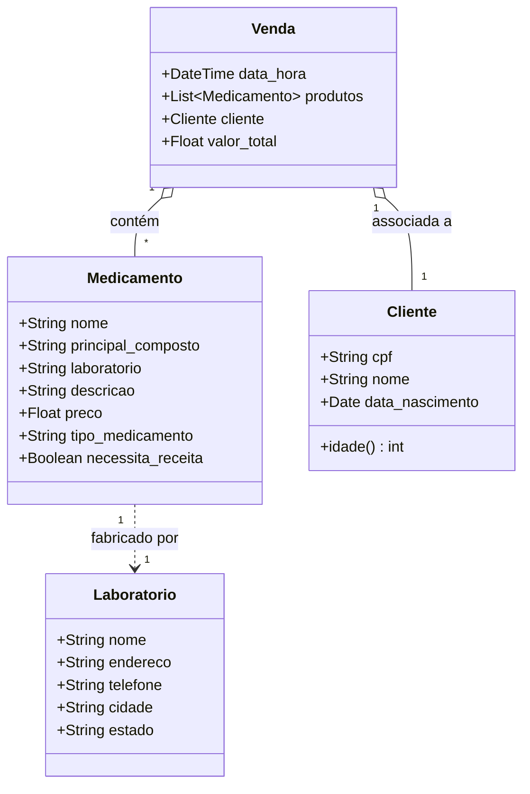

# 💊 Sistema de Gestão de Drogaria (POO em Python)

Projeto prático desenvolvido no programa **Santander Coders** para consolidar os conceitos de **Programação Orientada a Objetos (POO)** em Python.

O sistema simula as operações centrais de uma farmácia/drogaria: cadastro de entidades, catálogo farmacêutico, controle de retenção de receitas, cálculo de descontos compostos e relatórios estatísticos de vendas.

---

## 🏛️ Modelagem Orientada a Objetos

O sistema foi modelado com foco na separação de responsabilidades e relacionamentos entre entidades:



---

## ⚙️ Regras de Negócio Implementadas

1. **Validação de Receita Médica:**
   - Medicamentos do tipo `quimioterápico` ou com a flag `necessita_receita = True` disparam alerta impeditivo no momento da venda, exigindo validação farmacêutica.
2. **Política de Descontos:**
   - **Desconto por Idade:** Clientes com mais de 65 anos recebem **20% de desconto** imediato.
   - **Desconto por Volume de Compra:** Compras com valor total superior a **R$ 150,00** recebem **10% de desconto adicional**.
3. **Persistência em Memória e Dados de Demonstração (Seed):**
   - O sistema inicializa com laboratórios, medicamentos e clientes pré-cadastrados, permitindo testar relatórios e vendas imediatamente.
4. **Relatórios e Métricas Diárias:**
   - Listagem ordenada de clientes e catálogo de medicamentos.
   - Filtros por categoria (Quimioterápicos vs. Fitoterápicos).
   - Estatísticas gerenciais: medicamento mais vendido, quantidade de clientes únicos atendidos, contagem por tipo de medicamento e receita financeira apurada.

---

## 🚀 Como Executar

Não requer bibliotecas externas (utiliza apenas a biblioteca padrão do Python):

```bash
cd 01-projetos/02-sistema-drogaria-poo
python main.py
```

### Exemplo de Uso
1. Ao iniciar o programa, escolha `3` para **Realizar venda**.
2. Digite o CPF de um cliente de teste (ex: `111.222.333-44` para testar o desconto de idoso).
3. Adicione produtos (ex: `Imatinibe`, `Passiflora`) e digite `fim`.
4. Observe a validação de receita para medicamentos controlados e o cálculo detalhado de descontos no comprovante.
5. Acesse o menu `4` para visualizar os relatórios e estatísticas consolidadas.
